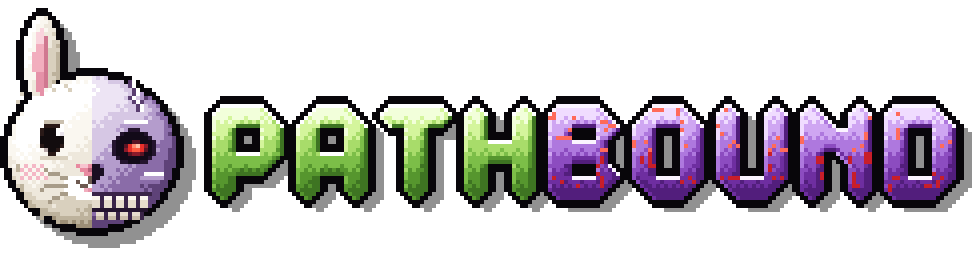
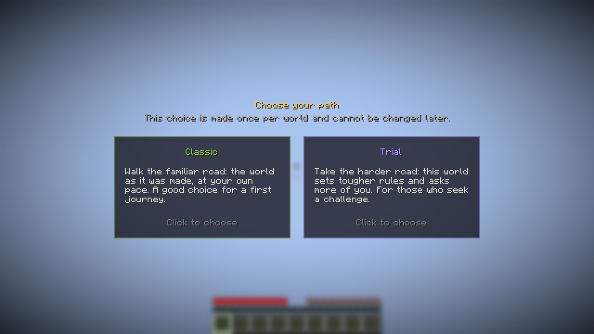
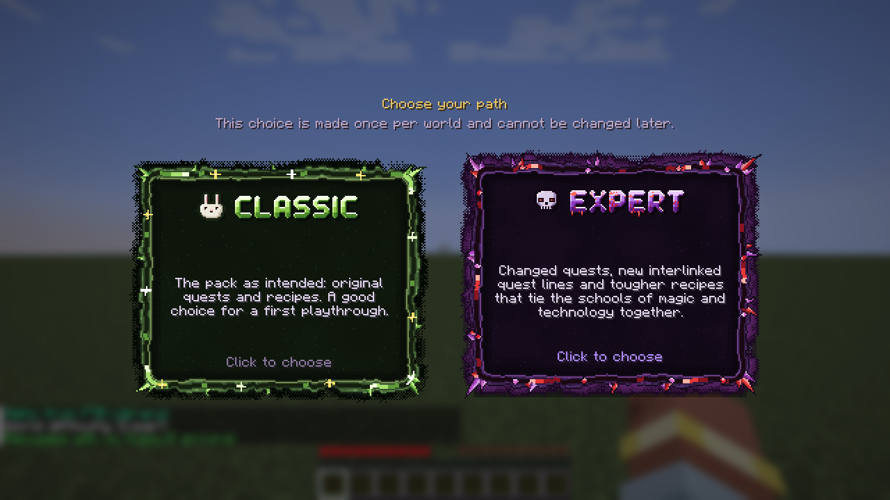

<p align="center"></p>

**Choose your path — once per world.**

When a new world is created, its host picks a difficulty on a dedicated screen: **Classic** or **Trial**. The choice is stored in the world and cannot be changed from the game. Pathbound then applies it for everyone: player stages, datapacks, commands. Modpacks decide what each path actually means.

Everything is data. You can rename the difficulties, add your own, give them recipes and quests, and restyle the whole screen without writing a line of Java.


*Pathbound out of the box: Classic and Trial.*

## What it does

- **A one-time choice.** The world host (or an operator on a server) sees the chooser on first join. Esc does not close it. Other players see a "the host is choosing" notice and can keep playing.
- **Player stages.** Every difficulty grants its own stages (player tags, the same stages KubeJS and FTB Quests read) and removes the stages of the others. Quests, recipes and scripts can react to them.
- **Datapacks per difficulty.** A difficulty can switch datapacks on: different recipes, loot or worldgen data for Trial worlds only. Packs can ship them in `config/pathbound/datapacks/`, no extra jar needed.
- **Commands on choice.** Run any server commands once when a difficulty is picked (gamerules, `/difficulty`, scoreboard, functions).
- **Fully restylable screen.** Card size and layout, colours, background, frame sprites (nine-slice, animated), item or texture icons, drawn title images per language, sounds and animations, all from a resource pack.
- **KubeJS support (optional).** Add or change difficulties from scripts, refuse a choice, react after it, read and set the difficulty.
- **Server friendly.** `defaultMode` in the server config picks a difficulty for new worlds automatically and skips the screen.
- **Any language.** Names, descriptions and title images can be set per language (`en_us`, `de_de`, `pt_br`...), and the screen texts come from ordinary lang files, so you can translate everything yourself.

Commands: `/pathbound mode`, `/pathbound mode set <id|none>`, `/pathbound choose` (show the screen again), `/pathbound list`. Changing the difficulty needs operator rights or the singleplayer world owner (cheats not required).

## Example: Thaumaturge Renaissance (custom version)

> **This is a customised setup from the Thaumaturge Renaissance modpack, not what Pathbound looks like by default.** The frames, drawn titles and the rabbit and skull icons belong to the pack and are not included in the mod.


*Custom version: animated pixel-art frames, drawn titles, icons and a hover glow from the pack's resources.*

What the pack does with Pathbound:

- renames the two paths to **Classic** and **Expert** and writes its own descriptions;
- gives each one a stage (`trq_normal` / `trq_hard`): FTB Quests shows Expert-only quest lines only in Expert worlds;
- turns on an Expert recipe datapack from `config/pathbound/datapacks/trq_hard` in Expert worlds only;
- replaces the plain cards with its own frames, titles and icons through `kubejs/assets`.

All of it is config and resources. The pack has no code of its own for this.

## Make your own difficulties: a mini guide

**1. Open the config.** Start a world once, then open `config/pathbound/difficulties.json`. Each entry is one card:

```json
{
  "id": "trial",
  "name": { "en_us": "Trial", "de_de": "Prüfung" },
  "description": "Tougher recipes and no keepInventory.",
  "color": "#B48CFF",
  "icon": "minecraft:wither_skeleton_skull",
  "order": 1,
  "stages": ["mypack_trial"],
  "datapacks": ["config:trial_recipes"],
  "commands": ["gamerule keepInventory false"]
}
```

**2. Rename or recolour.** Change `name`, `description` (plain text, or one text per language like `{"en_us": "...", "de_de": "..."}`) and `color`. `icon` takes an item id or a texture.

**3. Add or remove a difficulty.** Copy an entry and give it a new `id` (lowercase letters, digits, `_`). Delete an entry to remove it. `order` sets the card order. `"selectable": false` hides a card but keeps the difficulty for commands.

**4. Give it recipes or loot.** Put a normal datapack (a folder with `pack.mcmeta`, or a `.zip`) into `config/pathbound/datapacks/` and list it as `"config:<name>"` in `datapacks`. Pathbound enables it only in worlds with that difficulty.

**5. Hook up quests and scripts.** Use the difficulty's stage, for example a stage task `mypack_trial` in FTB Quests (it reads stages through KubeJS and FTB XMod Compat), or `player.stages.has('mypack_trial')` in KubeJS.

**6. Run commands.** Add them to `commands`. They run once, as the server, right after the datapacks reload.

**7. Restyle the screen (optional).** In a resource pack (or `kubejs/assets/`) add:

- `assets/pathbound/chooser/layout.json` for card size, padding, colours, background, sounds and animations;
- frame sprites `assets/<yourpack>/textures/gui/sprites/<path>.png` (plus `_hovered` and `_selected`), then set `"frame": "<yourpack>:<path>"` on a difficulty;
- `"banner"` on a difficulty for a drawn title image, one per language if you like.

**8. Apply and test.** Restart the world (or the server), then run `/pathbound choose` to see the screen again. `/pathbound list` shows what was loaded. For servers, set `defaultMode = "trial"` in `config/pathbound-server.toml` to skip the screen.

The full reference (every field, layout keys, animations, KubeJS events) is in the README.

---

*NeoForge 1.21.1 (21.1.265+). Required on both client and server. KubeJS and FTB Quests are optional.*
