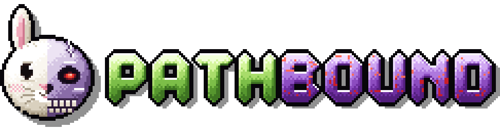
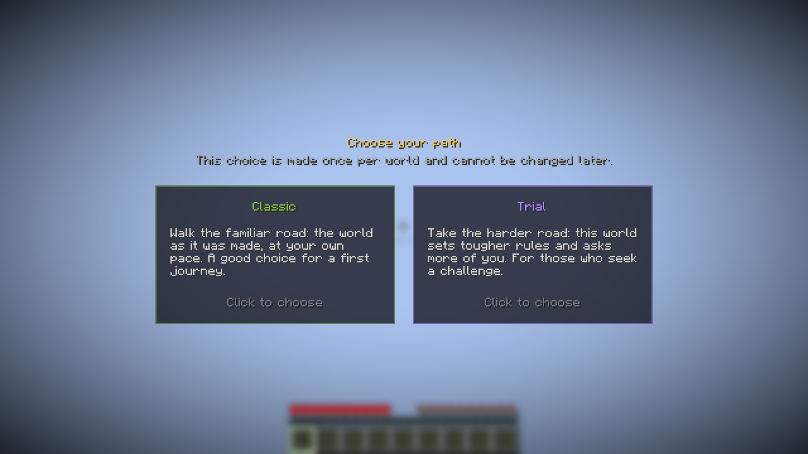
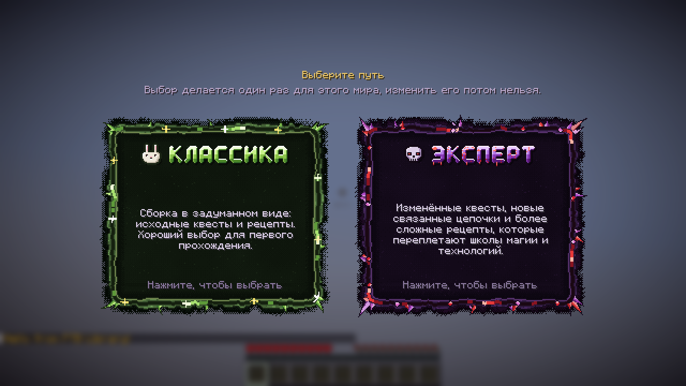
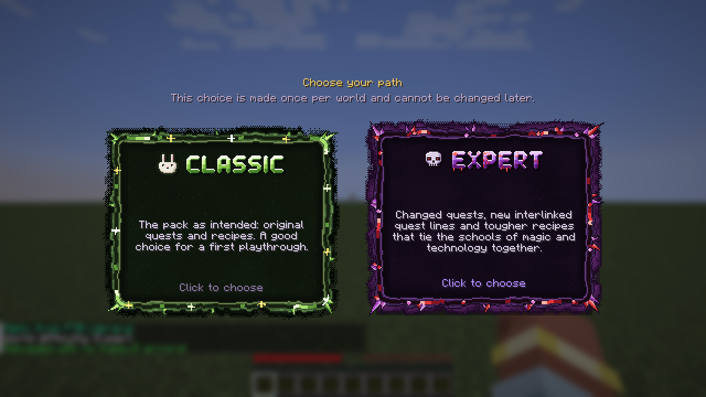

<p align="center"></p>

**Выберите путь — один раз на мир.**

При создании мира хозяин выбирает сложность на отдельном экране: **Классика** или **Испытание**. Выбор хранится в мире, из игры его не изменить. Pathbound применяет его ко всем игрокам: стадии, датапаки, команды. Что значит каждый путь, решает сборка.

Всё задаётся данными. Сложности можно переименовать, добавить свои, дать им рецепты и квесты и полностью перекрасить экран, не написав ни строчки на Java.


*Pathbound из коробки: Classic и Trial.*

## Что делает мод

- **Выбор один раз.** Хозяин мира (или оператор на сервере) видит экран выбора при первом входе. Esc его не закрывает. Остальные игроки видят «Хозяин мира выбирает сложность…» и могут играть дальше.
- **Стадии игрока.** Каждая сложность выдаёт свои стадии (теги игрока — их же читают KubeJS и FTB Quests) и снимает стадии остальных. На них можно завязать квесты, рецепты и скрипты.
- **Датапаки по сложности.** Сложность может включать датапаки: свои рецепты, лут или данные мира только для миров «Испытания». Сборка кладёт их в `config/pathbound/datapacks/`, отдельный jar не нужен.
- **Команды при выборе.** Любые серверные команды один раз при выборе сложности: правила игры, `/difficulty`, табло, функции.
- **Экран меняется целиком.** Размер и расположение карточек, цвета, фон, спрайты рамок (nine-slice, с анимацией), иконки-предметы или картинки, нарисованные заголовки для каждого языка, звуки и анимации — всё из ресурс-пака.
- **Поддержка KubeJS (по желанию).** Добавлять и менять сложности скриптами, запрещать выбор, реагировать на него, читать и задавать сложность.
- **Для серверов.** `defaultMode` в конфиге сервера сам выбирает сложность для новых миров, экран не показывается.
- Есть английский и русский языки.

Команды: `/pathbound mode`, `/pathbound mode set <id|none>`, `/pathbound choose` (показать экран снова), `/pathbound list`. Менять сложность могут операторы и хозяин одиночного мира (читы не нужны).

## Пример: Thaumaturge Renaissance (кастомная версия)

> **Это настроенный вариант из сборки Thaumaturge Renaissance, а не стандартный вид Pathbound.** Рамки, нарисованные заголовки и иконки кролика и черепа — ресурсы сборки, в мод они не входят.


*Кастомная версия: анимированные пиксельные рамки, нарисованные заголовки и иконки из ресурсов сборки.*


*Та же настройка на английском, карточка «Эксперта» под курсором: у каждого языка свои заголовки.*

Что сборка делает с Pathbound:

- называет пути **Классика** и **Эксперт** и пишет свои описания;
- даёт каждому стадию (`trq_normal` / `trq_hard`): FTB Quests показывает квесты «Эксперта» только в мирах «Эксперта»;
- в мирах «Эксперта» включает датапак с рецептами из `config/pathbound/datapacks/trq_hard`;
- заменяет простые карточки своими рамками, заголовками и иконками через `kubejs/assets`.

Всё это — конфиг и ресурсы. Своего кода для этого у сборки нет.

## Свои сложности: мини-гайд

**1. Откройте конфиг.** Запустите мир один раз и откройте `config/pathbound/difficulties.json`. Каждая запись — одна карточка:

```json
{
  "id": "trial",
  "name": { "en_us": "Trial", "ru_ru": "Испытание" },
  "description": { "en_us": "Tougher recipes and no keepInventory.", "ru_ru": "Сложные рецепты, вещи выпадают." },
  "color": "#B48CFF",
  "icon": "minecraft:wither_skeleton_skull",
  "order": 1,
  "stages": ["mypack_trial"],
  "datapacks": ["config:trial_recipes"],
  "commands": ["gamerule keepInventory false"]
}
```

**2. Переименуйте или перекрасьте.** Меняйте `name`, `description` (просто текст или по тексту на язык) и `color`. В `icon` — id предмета или текстура.

**3. Добавьте или уберите сложность.** Скопируйте запись и дайте новый `id` (строчные латинские буквы, цифры, `_`). Удалите запись, чтобы убрать сложность. `order` задаёт порядок карточек. `"selectable": false` прячет карточку, но сложность остаётся для команд.

**4. Дайте ей рецепты или лут.** Положите обычный датапак (папку с `pack.mcmeta` или `.zip`) в `config/pathbound/datapacks/` и впишите его в `datapacks` как `"config:<имя>"`. Pathbound включит его только в мирах с этой сложностью.

**5. Подключите квесты и скрипты.** Используйте стадию сложности: например, задание-стадию `mypack_trial` в FTB Quests (стадии он читает через KubeJS и FTB XMod Compat) или `player.stages.has('mypack_trial')` в KubeJS.

**6. Добавьте команды.** Впишите их в `commands`. Они выполнятся один раз от имени сервера сразу после перезагрузки датапаков.

**7. Измените вид экрана (по желанию).** В ресурс-пак (или в `kubejs/assets/`) добавьте:

- `assets/pathbound/chooser/layout.json` — размер карточек, отступы, цвета, фон, звуки и анимации;
- спрайты рамок `assets/<ваш_пак>/textures/gui/sprites/<путь>.png` (и `_hovered`, `_selected`), а у сложности — `"frame": "<ваш_пак>:<путь>"`;
- `"banner"` у сложности — картинка-заголовок, можно отдельную для каждого языка.

**8. Примените и проверьте.** Перезапустите мир (или сервер) и выполните `/pathbound choose`, чтобы снова увидеть экран. `/pathbound list` покажет, что загрузилось. На сервере `defaultMode = "trial"` в `config/pathbound-server.toml` пропускает экран.

Полный справочник (все поля, ключи layout, анимации, события KubeJS) — в README.

---

*NeoForge 1.21.1 (21.1.265+). Нужен на клиенте и на сервере. KubeJS и FTB Quests — по желанию.*
