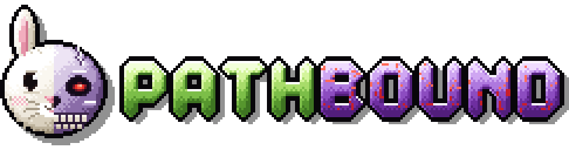

<p align="center"></p>

A NeoForge 1.21.1 mod (NeoForge 21.1.265+). On first join the world's host picks a path, **Classic** or **Trial**, once per world. Difficulties, their player stages, datapacks and commands, and the look of the chooser are data: a config file, any resource pack and optional KubeJS scripts. A modpack needs no jar of its own.

## How it works

- While the world has no difficulty (`none`), the host (or an operator on a server) sees the chooser. Esc does not close it. Other players see "The world host is choosing the difficulty..." and can close that notice.
- The choice is stored in the world (`data/pathbound.dat`). Once a difficulty is chosen, the mod:
  - grants the players its stages (player tags, which are also KubeJS and FTB Quests stages) and removes the stages of the other difficulties;
  - enables its datapacks and disables those of the other difficulties (with a data reload);
  - runs its commands (after the data reload);
  - announces "World difficulty: ..." in chat.
- Commands:
  - `/pathbound mode` shows the current difficulty;
  - `/pathbound mode set <id|none>` changes it right away (stages, datapacks, commands);
  - `/pathbound choose` clears the choice and shows the chooser to the host again;
  - `/pathbound list` lists every difficulty with its stages and datapacks.

  `set` and `choose` need permission level 2, or the owner of a singleplayer world (cheats not required). FTB Quests already completed for the previous difficulty are not reverted.

## Out of the box

Two difficulties: `classic` ("Classic", stage `pathbound_classic`) and `trial` ("Trial", stage `pathbound_trial`). The screen shows plain cards: a dark fill and a frame in the difficulty's colour, no images. The difficulties change nothing by themselves; the modpack decides what Trial means (datapacks, stages, commands). Images, frames and a custom `layout.json` come from a resource pack (see "Look of the screen").

## Difficulties: `config/pathbound/difficulties.json`

The file is written from the jar's template on the first world start and read on every world or server start. New template fields are not added to an existing file.

```json
{
  "difficulties": [
    {
      "id": "trial",
      "name": { "en_us": "Trial", "de_de": "Prüfung" },
      "description": "Tougher recipes.",
      "color": "#B48CFF",
      "icon": "mypack:textures/gui/skull.png",
      "banner": { "en_us": "mypack:textures/gui/trial_en.png", "de_de": "mypack:textures/gui/trial_de.png" },
      "frame": "mypack:chooser/trial",
      "order": 1,
      "selectable": true,
      "stages": ["mypack_trial"],
      "datapacks": ["config:trial_recipes", "file/extra.zip"],
      "commands": ["gamerule keepInventory false"]
    }
  ]
}
```

| Field | Meaning |
|---|---|
| `id` | `a-z 0-9 _`, up to 32 characters, not `none`. Stored in the world; case does not matter in commands. |
| `name`, `description` | A string (as is), `{"translate": "key"}`, or one text per language `{"en_us": "...", "de_de": "..."}` (the player's language, else en_us). |
| `color` | `"#RRGGBB"`, `"#AARRGGBB"` or a number. Colour of the name, the hint, the glow and the plain frame. |
| `icon` | An item id (`minecraft:torch`) or a texture (`ns:textures/gui/x.png`, drawn at its own size). Optional. |
| `banner` | A drawn title in place of the name: a texture id, or one per language. Drawn at its own size, 1 texel = 1 GUI pixel. The name is still used in chat and in the confirmation. |
| `frame` | The card's own frame sprite (see below). |
| `order` | Card order (ascending). |
| `selectable` | `false` hides the card; the difficulty can then be set only by a command or the config. |
| `stages` | Player tags = KubeJS / FTB Quests stages. |
| `datapacks` | `config:name` is a folder or `name.zip` in `config/pathbound/datapacks/`; `builtin:name` is the folder `datapacks/name` in the mod jar; anything else is a pack id as in `/datapack list` (`file/...`). |
| `commands` | Server commands (permission level 4), run once on the choice, after the data reload. |

**Difficulty datapacks without a mod of your own.** Put a datapack (a folder with `pack.mcmeta`, or a `.zip`) into `config/pathbound/datapacks/` and list it as `"config:name"`. Such packs are never enabled on their own: Pathbound turns them on only in worlds with that difficulty.

**Server.** `config/pathbound-server.toml`: `defaultMode = "none"` or a difficulty id. That difficulty is applied at server start to a world without one, and the chooser is not shown.

## Look of the screen

The jar ships no images and no `layout.json`; without them the chooser draws plain cards. Put your theme into any resource pack or `kubejs/assets/`: `assets/pathbound/chooser/layout.json` plus textures under your own namespace.

`assets/pathbound/chooser/layout.json`, every key optional:

```json
{
  "background": { "blur": true, "texture": "mypack:textures/gui/chooser_bg.png", "tile": false, "color": "#700D0711" },
  "title":    { "text": { "translate": "pathbound.title" }, "color": "#E8C46A" },
  "subtitle": { "text": { "translate": "pathbound.subtitle" }, "color": "#B8A6C8" },
  "card": {
    "width": 190, "min_height": 110, "spacing": 14, "columns": 0, "padding": 12,
    "text_align": "left", "frame_inset": 0,
    "frame": "mypack:chooser/card", "tint_frame": false,
    "color": "#C0101018", "hover_color": "#E0201A2C",
    "text_color": "#E2D6EE", "name_color": "#FFFFFF", "hint": { "translate": "pathbound.pick" }, "hint_color": "#8C7AA0",
    "icons": true
  },
  "sounds": { "hover": "minecraft:ui.button.click", "click": "minecraft:ui.button.click" },
  "confirm": true
}
```

- `columns: 0` fits as many cards per row as the screen allows. Cards wrap into rows; when they do not fit, the grid scrolls with the mouse wheel.
- Without `name_color` the name is drawn in the difficulty's colour.
- `text_align: "center"` centres the description on the card and halfway between the header and the hint (default `left`).
- `frame_inset` is how many pixels at the sprite's edge are transparent (spikes, fog). The glow and the shadow under a card follow the visible frame (default 0). One value for all frames.
- `color` and `hover_color` apply to the plain frame only; a sprite draws its own background.
- `confirm: false` skips the "Play in ... mode?" dialog. The card stays selected (`_selected`) until the server answers.
- The screen's texts are the `pathbound.*` keys in `assets/pathbound/lang/<language>.json`; add a lang file to translate them.

### Animations

All in the `"animations"` block of layout.json; `"animations": false` turns them all off. Defaults:

```json
"animations": {
  "fade_ms": 250,            // background and title fade in
  "intro_ms": 380,           // one card slides up
  "stagger_ms": 70,          // delay between cards
  "intro_offset": 14,        // how far below a card starts, px
  "easing": "ease_out_back", // linear | ease_out | ease_in_out | ease_out_back (slight overshoot)
  "hover_lift": 4,           // a hovered card rises, px (with a shadow under it)
  "hover_ms": 70,            // rise speed: half the way in this time
  "press_ms": 140,           // a clicked card dips before the confirmation opens
  "press_scale": 0.96,
  "glow": true,              // glow in the difficulty colour around a raised or selected card
  "hint_pulse_ms": 1400,     // "Click to choose" breathes under the cursor; 0 = no pulse
  "selected_pulse_ms": 900,  // pulse of the selected card's glow
  "icon_bob": 1              // a hovered card's icon bobs, px; 0 = no
}
```

Animations are time-based, not frame-based, so they do not depend on the frame rate. The intro plays once: it does not repeat after returning from the confirmation.

### Frame sprites

A GUI sprite is `assets/<ns>/textures/gui/sprites/<path>.png`, id `<ns>:<path>`. States: `<path>.png` (normal), `<path>_hovered.png` (under the cursor), `<path>_selected.png` (chosen). A missing state falls back to the normal sprite; a missing sprite to the plain frame. Lookup order: the difficulty's `frame`, then `card.frame` from layout.json.

Scaling is set in `<path>.png.mcmeta` (like vanilla 1.21 sprites), optionally with an animation:

```json
{ "animation": { "frametime": 4, "width": 224, "height": 192 },
  "gui": { "scaling": { "type": "nine_slice", "width": 224, "height": 192, "border": 32 } } }
```

- `nine_slice`: the `border`×`border` corners are not stretched; edges and middle repeat to fit the card.
- Other types: `stretch` (stretch everything), `tile` (`{"type": "tile", "width": 16, "height": 16}`, repeat).
- Keep layout.json's `padding` larger than the frame's visible thickness, or the text lands on the frame.
- `tint_frame: true` tints the sprite with the difficulty's colour; draw the frame in greys for that.

## KubeJS

The KubeJS module loads only when KubeJS is installed (`kubejs.plugins.txt`). Without KubeJS the mod works the same, just without scripts.

**Startup script** (`kubejs/startup_scripts/`), runs when a world starts, after the config is read:

```js
PathboundEvents.register(e => {
  e.add('nightmare', d => d
    .name({ en_us: 'Nightmare', de_de: 'Albtraum' })    // or .name('Nightmare') / .nameKey('my.key')
    .description('No mercy.')
    .color('#FF5050').icon('minecraft:wither_rose').order(2)
    .stage('nightmare')
    .datapack('config:nightmare')
    .command('difficulty hard')
    .frame('mypack:chooser/nightmare'))
  e.modify('trial', d => d.color(0xFF8040))               // change a difficulty from the config
  e.remove('classic')                                      // remove one
  console.info(e.ids)
})
```

Builder methods: `name`, `nameKey`, `description`, `descriptionKey`, `color`, `icon`, `banner`, `order`, `selectable`, `stage`, `clearStages`, `datapack`, `clearDatapacks`, `command`, `frame`.

**Server scripts** (`kubejs/server_scripts/`):

```js
// e.cancel() refuses the choice: the player sees "You cannot choose ... now." and the chooser comes back
PathboundEvents.beforeChoose(e => {
  if (e.difficulty == 'nightmare' && !e.player.stages.has('veteran')) e.cancel()
})
// after the choice (e.player is null when the config or a command set it)
PathboundEvents.afterChoose(e => {
  e.server.tell(`Difficulty: ${e.difficulty}`)
})
// a player joins a world that already has a difficulty
PathboundEvents.playerJoin(e => console.info(`${e.player.username}: ${e.difficulty}`))

// binding
Pathbound.get(server)             // 'trial' | 'none' | ...
Pathbound.set(server, 'classic')  // like /pathbound mode set; false for an unknown id
Pathbound.ids()                   // ['classic', 'trial', ...]
Pathbound.info('trial')           // the difficulty's data
Pathbound.isChosen(server)
```

Working test scripts are in `src/clientValidation/kubejs/`.

Java API for other mods: `dev.pathbound.DifficultyApi.get/set/difficulties`, hooks `dev.pathbound.Hooks.register/beforeChoose/afterChoose/playerJoin`.

## Building and checks

```bash
./gradlew build
```

`build` also runs the JUnit tests of the animation math.

```bash
./gradlew runGameTestServer > run.log 2>&1; grep -E "required tests (passed|failed)" run.log
```

```bash
./gradlew runDifficultyValidation -PvalidationChoice=hard -PvalidationProps="pathbound.sizes=true"
```

```bash
./gradlew runDifficultyValidation -PvalidationChoice=nightmare -PvalidationProps="pathbound.expectCards=3;pathbound.refuseFirst=hard;pathbound.expectTorch=1;pathbound.expectTag=kjs_after_choose_nightmare"
```

- GameTests: saved data, config parsing, stages, a datapack from `config/pathbound/datapacks` (`src/gameTest/config`), a third difficulty (built-in datapack, stage, command), `defaultMode`, commands.
- The client check runs the mod against a real modpack (Thaumaturge Renaissance): its `config/pathbound` (`-PpackConfig=...`), its chooser theme (`-PpackAssets=...`), its FTB quests (`-PquestSource=...`), and FTB Quests and KubeJS from its `mods` folder (`-PpackMods=...` or `packMods=...` in an untracked `local.properties`; `-PnoPackMods` runs without them). A fresh flat world, a choice through the real screen, checks of the server, recipes and quests. Frames and `proof.txt` go to `build/ci/difficulty/<name>/`.
- The server checks (`runServerCheck`, `runServerCheckKubejs`, `runServerCheckDefault`) need an `eula.txt` in their run folder.

The project icon is `branding/icon.png`. The mod list logo (`pathbound_logo.png` in the jar) and the logo above are drawn pixel art in `branding/`.

---

License: [MIT](LICENSE).
